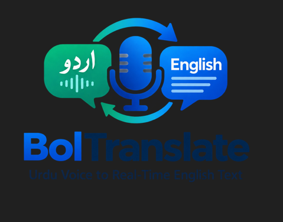

# BolTranslate 🎙️➡️📝

> **Real-Time Urdu Voice to English Translation Powered by Faster-Whisper AI, Next.js 16, FastAPI & SQLite**

<p align="center">
  
</p>

<p align="center">
  <b>اردو آواز سے براہ راست ریئل ٹائم انگلش ترجمہ</b><br>
  Built with ❤️ for real-time speech translation and AI voice prompting.
</p>

---

## ✨ Features

- 🎙️ **Real-Time Urdu Voice-to-English:** Speak in Urdu, and get instant English text with low latency.
- 🎨 **Logo-Matched Futuristic UI:** Custom dark neon theme with Emerald Green (`#10B981`) for Urdu voice and Electric Blue (`#3B82F6`) for English translation.
- 📱 **100% Mobile Responsive & PWA Installable:** Install directly as a native app on Android and iOS (Progressive Web App).
- 🤖 **One-Click AI Prompting:** Send translated sentences directly to **ChatGPT**, **Google Gemini**, or **Claude AI** with a single click.
- 🗄️ **Persistent SQLite Database:** All translated conversations are saved permanently in `boltranslate.db` with bookmarking (⭐ Star) and deletion support.
- 🔊 **English Text-to-Speech (TTS):** Listen to translated English sentences in a natural accent with the built-in Speak button.
- 🆓 **100% Free & Open-Source:** Uses local `faster-whisper` (CTranslate2 int8 quantized model) — zero paid API subscriptions required.

---

## 🏛️ System Architecture

```text
[ Browser / Mobile Client (Next.js 16) ]
               │
               ▼ (WebSocket Audio Stream)
[ FastAPI Python Backend (port 8000) ]
               │
      ┌────────┴────────┐
      ▼                 ▼
[ Faster-Whisper ]   [ SQLite DB ]
(Urdu -> English)    (boltranslate.db)
```

---

## 🚀 Quick Start Guide

### Prerequisites
- Node.js 18+ & npm
- Python 3.10+
- Git

### 1. Clone the Repository
```bash
git clone https://github.com/aurangzaibmughal/boltranslate.git
cd boltranslate
```

### 2. Backend Setup (FastAPI + Faster-Whisper)
```bash
cd backend
python -m pip install -r requirements.txt
python main.py
```
*Backend runs on: `http://localhost:8000` and WebSocket `ws://localhost:8000/ws`*

### 3. Frontend Setup (Next.js 16)
```bash
cd ../frontend
npm install
npm run dev
```
*Frontend runs on: `http://localhost:3000`*

---

## 📱 Mobile Access (Same Wi-Fi)
Open your phone's browser and navigate to:
```text
http://<YOUR_PC_IP>:3000
```
Tap **"Add to Home Screen"** or **"Install App"** in your mobile browser to install BolTranslate as a native mobile application!

---

## 🛠️ Tech Stack

- **Frontend:** Next.js 16 (App Router), React 19, Tailwind CSS v4, Lucide Icons
- **Backend:** FastAPI, WebSockets, Uvicorn, Pydantic
- **AI Model:** Faster-Whisper (`Systran/faster-whisper-base` with int8 quantization)
- **Database:** SQLite with SQLAlchemy ORM
- **Audio Processing:** Web Audio API, MediaRecorder, PyAV, imageio-ffmpeg

---

## 👨‍💻 Author

**Aurangzaib Mughal**
- GitHub: [@aurangzaibmughal](https://github.com/aurangzaibmughal)

---

## 📄 License
This project is open-source under the MIT License.
